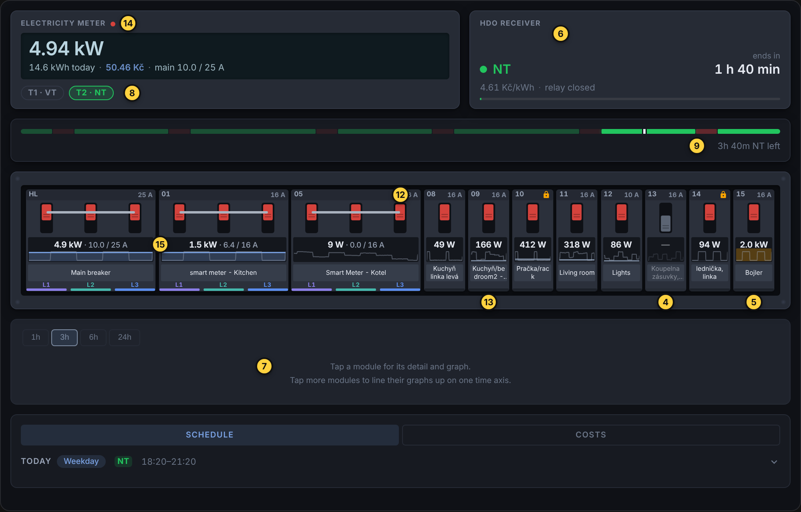
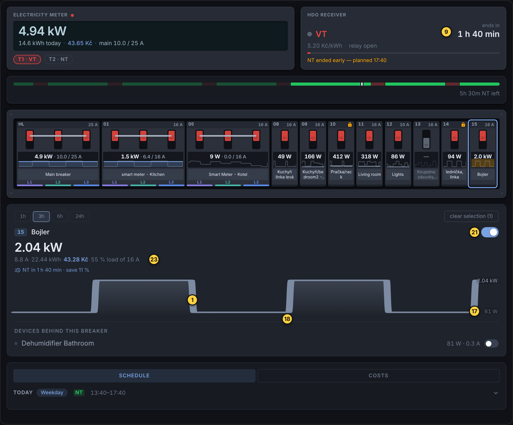
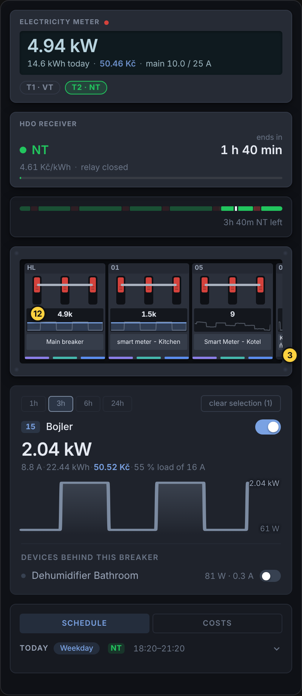
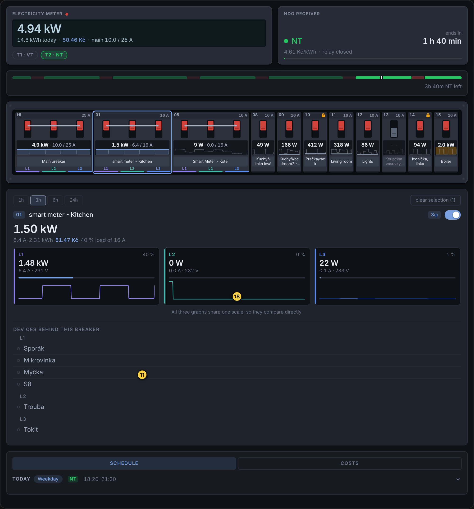

# Rozbor grafiky a UX — Electricity Panel Card v5.7.0

Navazuje na `docs/DESIGN-REVIEW.md` (v5.2.1, balíčky A–D). Ten řešil classic view;
tento rozbor se týká hlavně **`view: panel`**, protože v něm karta na dashboardu běží.

**Podklad.** Sestavený `dist/` v5.7.0 vyrenderovaný v harnessu s tvou skutečnou
konfigurací (`rail_size: 17`, 8 jističů + 2× 3f + hlavní, `follow_theme: false`)
a syntetickými daty. Šířky 400 / 1000 / 1500 px, tmavé i světlé téma, NT i VT,
stavy: nic nevybráno, 1f detail, 3f detail, porovnání, rozvrh, náklady.
Čísla v textu (px, kontrasty) jsou změřená na renderu, ne odhadnutá z CSS.

Čísla v kolečkách na obrázcích odpovídají číslům nálezů.

---

## Co funguje a nemá se měnit

- **Barevná disciplína z balíčku A drží.** Zelená/červená je na celé kartě jen tarif,
  amber jen varování (s jednou výjimkou — nález 5).
- **Nakreslený rozvaděč je čitelný na první pohled**: poloha páčky + barva nesou stav
  dvakrát, vypnutý modul 13 je vidět periferně.
- **Společná osa Y** v 3f detailu a porovnání — bez ní by ty grafy lhaly.
- Klávesnice (`role`, `aria-pressed`, `:focus-visible`) a `prefers-reduced-motion` jsou ošetřené.

---

## E — Defekty (opravit jako první)

**1. Graf v detailu má zkreslenou tloušťku čáry.**
`_renderSparkline` kreslí do `viewBox 100×38` s `preserveAspectRatio="none"`, ale
čára nemá `vector-effect="non-scaling-stroke"` (na rozdíl od `_renderScaledSpark`,
který ho má). V detailu je SVG ~900 × 74 px, takže se tah 1,5 roztáhne na
**13,5 px ve svislých hranách a 2,9 px ve vodorovných**. Každé sepnutí bojleru
vypadá jako tlustý sloup. V classic buňkách (~300 px) je to 4,5 vs. 1,5 px —
méně, ale taky vidět. Stejně se deformuje hover tečka (elipsa).
→ Jeden atribut na `<path>`, tečku kreslit HTML překryvem nebo přepočítat `rx/ry`.

**2. Klik na modul výběr vždy rozšiřuje.**
`_panelTogglePick` přidává do seznamu. Nejčastější záměr „ukaž mi teď jiný jistič"
proto skončí porovnáním dvou modulů; správná cesta je klik na starý (odznačit)
nebo „clear selection" a pak teprve nový. Porovnání je výjimečná akce, a má
výchozí chování.
→ Klik = nahradit výběr (klik na vybraný = zavřít). Porovnání explicitně:
přepínač „compare" v liště nástrojů vedle 1h/3h/6h/24h; teprve s ním kliky přidávají.

**3. Na úzké kartě je vidět 55 % lišty a nic nenaznačuje, že pokračuje.**
Při 400 px má lišta 638 px obsahu v 348 px výřezu. První tři moduly jsou 3f
(9 pozic), takže **všech 8 jednofázových jističů je mimo obraz**. Výřez nemá
okrajový přechod ani jiný náznak rolování, a vybraný modul se sám neodroluje do
záběru — na obr. 3 je otevřený detail Bojleru (poz. 15), který na liště není vidět.
→ Minimum: `scrollIntoView({inline:'nearest'})` po výběru + maska na okraji
výřezu, kde obsah pokračuje. Větší krok: lištu automaticky zalomit do řad, když
by pozice klesla pod ~44 px (17 → 9 + 8). To není zmáčknutí, které jsi v 5.6.0
odmítl — moduly zůstanou čitelně široké, jen na dvou lištách.

**4. „—" na displeji modulu znamená tři různé věci.**
`fmtModuleW` vrací „—" pro cokoli ≤ 0 W: zapnutý okruh bez odběru, vypnutý jistič
i nedostupný senzor (`_watts` vrací pro `unavailable` nulu). Zrovna stav
„senzor neodpovídá" je ten, který potřebuješ poznat.
→ `0 W` tlumeně pro zapnutý bez odběru; „—" nechat vypnutému; nedostupný senzor
odlišit (např. `?` a šrafovaný displej, amber — je to varování).

**5. Amber začíná na 55 % zatížení.**
`_loadColor`: > 55 % amber, > 80 % červená. 2kW bojler na 16A jističi je ~54 %,
takže displej modulu svítí „varováním" pokaždé, když bojler topí, a kolem prahu
bude podle napětí přeskakovat. Amber je přitom vyhrazený varování (balíček A) a
jistič snese jmenovitý proud trvale.
→ Neutrál < 50 %, akcent 50–80 %, amber 80–95 %, červená ≥ 95 % (tam už dnes
začíná animace `ep-overload`). Platí pro oba režimy.

---

## F — Prostor a hierarchie

Výchozí stav při 1000 px má 638 px. Prázdný detail (107 px), samostatná karta
kvůli 6px pruhu osy (54 px) a prázdná horní část přijímače (29 px) dohromady
zaberou ~190 px, tedy skoro třetinu výšky.

**6. HDO přijímač má prázdnou horní třetinu; časová osa je samostatná karta kvůli 6px pruhu.**
`.rx-main { margin-top: auto }` tlačí obsah dolů a pod potiskem zůstává 29 px prázdna.
Hned pod tím je karta `day-timeline` vysoká 54 px, v níž je pruh a jeden řádek textu.
→ Osu přesunout do přijímače jako jeho spodní část. `rx-prog` (průběh slotu) pak
odpadne — totéž ukazuje ryska „teď" na ose. **Úspora ~60 px** a tarif je celý na
jednom místě.

**7. Prázdný stav detailu zabírá 107 px.**
Dva řádky nápovědy v boxu, který je vidět pokaždé, když nic není vybráno — tedy
většinu času.
→ Když není nic vybráno, ukázat rozpad hlavního jističe po fázích (to, co dnes
ukáže klik na HL). Je to přirozené místo pro fázovou bilanci (ROADMAP 5.4 →
v5.8.0). Nápověda se zmenší na jeden řádek v liště nástrojů.
Levnější varianta: jen ten jeden řádek (−70 px).

**8. NT je na horních 200 px třikrát; čipy T1/T2 vypadají jako tlačítka.**
Čip `T2 · NT`, stav přijímače a barva osy říkají totéž. Čipy mají tvar pilulky
s okrajem — stejný jako `sday-btn` a `cost-pill`, které klikací jsou.
→ Registr přesunout dovnitř LCD jako značku (na skutečném elektroměru je to
šipka u T1/T2 na displeji), jen aktivní, bez pilulky.

**9. Dva odpočty, dva formáty, nejasný rozdíl.**
„ends in **1 h 40 min**" (konec slotu) a o 80 px níž „**3h 40m** NT left"
(zbývající NT dnes). Dál „20h 0m total", v řádcích rozvrhu „40m".
→ Jeden formátovač času pro celou kartu a popisky, které říkají čeho:
„NT ends in" / „NT in" / „NT left today".

**10. Rozvrh: 13 řádků se stejně dlouhými pruhy.**
`srow-fill` je průběh (0/100 %), ne délka — hodinové a čtyřhodinové okno vypadají
stejně. VT řádky (6× po 40 min) jsou doplněk NT a jen zdvojují výšku (967 px
rozbaleno).
→ Vypsat jen NT okna (7 řádků), pruh umístit na společnou 24h osu se šířkou podle
délky; průběh nechat jen aktivnímu řádku.

**11. 3f detail: poznámky o zařízeních v jednom sloupci.**
U kuchyně 7 řádků přes celou šířku (250 px), přitom skupiny se u tebe jmenují
L1/L2/L3 a fázové buňky jsou přímo nad nimi.
→ Zařízení vykreslit do tří sloupců pod příslušnou fází (classic to už umí —
`tp-devices-grid`).

---

## G — Grafy

**17. Osa Y začíná na `vMin`, ne na nule** (balíček D, stále otevřený).
Living room 273–365 W vyplní celou výšku grafu a vypadá jako divoké výkyvy.
→ Nula jako výchozí; přepínač není potřeba.

**18. Chybí časová osa; kurzor je jen v jednom ze tří typů grafu.**
Graf nemá jediný časový údaj — rozsah poznáš jen z tlačítka 3h. Tooltip
(hodnota · čas) má `_renderSparkline`, ale 3f buňky a porovnání (`_renderScaledSpark`)
ne — přitom právě v porovnání chceš vědět „co dělaly ostatní v tuhle chvíli".
→ Tři popisky pod grafem (začátek · střed · teď) a jeden kurzor synchronizovaný
přes všechny buňky porovnání.

**19. Tarifní pásma za grafem** (nová hodnota, ne oprava).
Karta zná okna NT/VT i historii přepínání. Tlumené zelené/červené pozadí za
křivkou v detailu odpoví na otázku, kvůli které karta existuje: „běželo to v NT?"
Zelená/červená zůstává výhradně tarifní, pravidlo z balíčku A to neporuší.

---

## H — Modul a čitelnost

**12. Text v modulu je 7,5–10,5 px a s šířkou neroste.**
Název 8–8,5 px, pozice 8,5, jmenovitý proud 8, popisek fáze 7,5 — vše pod
spodní hranicí škály z balíčku B (10 px). Úroveň detailu `l` (≥ 60 px) přidá jen
značky I/O. Na 1500 px je pozice široká 86 px, ale výška zůstává 128 px a písmo
stejné: 3f modul je 251 × 128 px, víc ležatý obdélník než jistič.
→ Na úrovni `l` hodnota 13 px, název 10 px; výšku modulu odvodit od šířky pozice
(strop ~150 px) nebo šířku pozice omezit na ~80 px a lištu vycentrovat.

**13. Názvy se lámou uprostřed slova.**
„Kuchyň/be|droom2 -..", „Pračka/rac|k". Za lomítkem prohlížeč zlom nenabízí,
takže zabere až `overflow-wrap`.
→ `<wbr>` za `/` a `,`. A volitelné pole `label` pro krátký název na čele modulu
(plný `name` zůstane v detailu a v `title`).

**14. Červená LED u „ELECTRICITY METER" svítí trvale.**
Statická červená tečka se čte jako chyba nebo nahrávání a je to druhá výjimka
z pravidla „červená = VT" (první je páčka, ta je obhájená konvencí).
→ Odstranit, nebo neutrální barva.

**15. Hlavní jistič je na kartě dvakrát se stejnými čísly.**
LCD: „4.94 kW … main 10.0 / 25 A". Modul HL o 150 px níž: „4.9 kW · 10.0 / 25 A".
→ V LCD místo jednoho čísla tři krátké pruhy L1/L2/L3 proti `main_breaker` —
nevyváženost fází na první pohled, bez klikání.

**16. Akcent začíná nést příliš významů.**
Modrá je dnes: přepínač, vybraný modul, aktivní tlačítko, čip pozice, **náklad v Kč**,
součet skupiny zařízení, NT tip a zatížení 15–55 %. Je to stejný mechanismus,
jakým zelená ztratila význam před balíčkem A.
→ Akcent jen pro interaktivní a vybrané. Náklad `--ep-text` s váhou 600, součty
`--ep-text-mid`.

**20. Kontrast sekundárního textu je pod 4,5 : 1.**

| Token | Kde | Dnes | Návrh |
|---|---|---|---|
| `--ep-text-dim` `#6b7688` | metriky, nápověda, „ends in", cena/relé | 3,8 / 3,4 / 3,1 : 1 (surface / surface-2 / cover) | `#8a95a8` → 5,8 / 5,2 / 4,7 |
| `--ep-mprint` `#7d8799` | potisk modulu a skříně (8–9 px) | 3,9–4,1 : 1 | `#8f99ab` → 4,9–5,1 |
| minulé úseky osy (opacity .32) | denní osa | 1,1–1,7 : 1 proti pozadí | opacity .5 |

Týká se jen vestavěné tmavé palety; `follow_theme` bere barvy z tématu.

**21. Ovládací prvky jsou menší než 24 px.**

| Prvek | Rozměr |
|---|---|
| přepínač jističe | 34 × 20 px |
| přepínač zařízení | 28 × 16 px |
| 1h / 3h / 6h / 24h | 33 × 21 px |
| clear selection | 106 × 22 px |
| hlavička rozvrhu (rozbalení) | výška 16 px |

Přepínač, který vypíná okruh, je nejmenší cíl na kartě.
→ Vzhled nechat, zvětšit zásahovou plochu (`::after` s přesahem / `min-height: 32px`).

**22. Potvrzení vypnutí je `window.confirm`.**
Nativní dialog blokuje stránku, nejde ostylovat a v companion aplikaci se chová
jinak než v prohlížeči.
→ Potvrzení přímo v hlavičce detailu: „Turn off Bojler?" + Cancel / Turn off.

**23. Řádek metrik v detailu je věta** (balíček C, pro panel view).
„8.8 A·22.44 kWh·43.28 Kč·55 % load of 16 A" — oddělovače nalepené na čísla,
u „43.28 Kč" chybí, že jde o dnešek.
→ Čtyři popsané hodnoty v mřížce (Current · Today · Cost today · Load). Místa je
v detailu dost.

**24. Světlé téma střídá čtyři odstíny pod sebou.**
Kryt `#eceff3`, osa a rozvrh `--ep-surface` (šedá), detail `--ep-surface-2` (bílá).
→ Detail a rozvrh na stejný povrch. Po nálezu 6 jedna z těch karet zmizí sama.

---

## Classic view

Nepoužíváš ho, ale je výchozí pro ostatní. Platí pro něj nálezy 1, 5, 17, 20, 21, 22
a zbytek balíčku C (razítko stáří dat až po překročení prahu — čerstvé má
dnes kontrast 1,7 : 1, tedy je vidět, ale nejde přečíst).

---

## Doporučené pořadí

| Krok | Nálezy | Rozsah | Poznámka |
|---|---|---|---|
| **E — opravy** | 1, 4, 5, 13 (`<wbr>`), 14, 20, 21 | malý, bez změny rozložení | patch |
| **F1 — interakce** | 2, 3 (scroll + maska), 22 | střední | mění chování kliku |
| **F2 — horní část** | 6, 8, 9, 15 | střední | nejdřív mockup |
| **G — grafy** | 17, 18, 19 | střední | 19 je jediná nová funkce |
| **H — detail a modul** | 7, 11, 12, 23, 10, 16, 24 | větší | 7 a 15 jsou příprava na fázovou bilanci |

E má nejlepší poměr dopad/riziko: sedm úprav, žádná nemění rozložení ani konfiguraci.
F2 a H se dotýkají vzhledu, který jsi schvaloval podle mockupu — tam mockup znovu.

## K rozhodnutí

1. **Nález 2** — porovnání přes přepínač „compare", nebo Ctrl/dlouhý stisk?
   Přepínač je objevitelný i na dotyku, proto ho doporučuju.
2. **Nález 3** — stačí scroll + maska, nebo i automatické zalomení lišty?
3. **Nález 7** — výchozí detail = fáze hlavního jističe, nebo jen zmenšit nápovědu?
4. **Nález 13** — chceš pole `label`, nebo stačí lepší lámání?

## Co vědomě nenavrhuju

Gradienty, glow, ikony okruhů, nové animace, přebarvení páčky a zaoblení nad 8 px —
dohodnutá omezení z předchozího kola platí a žádný nález výše je neporušuje.
